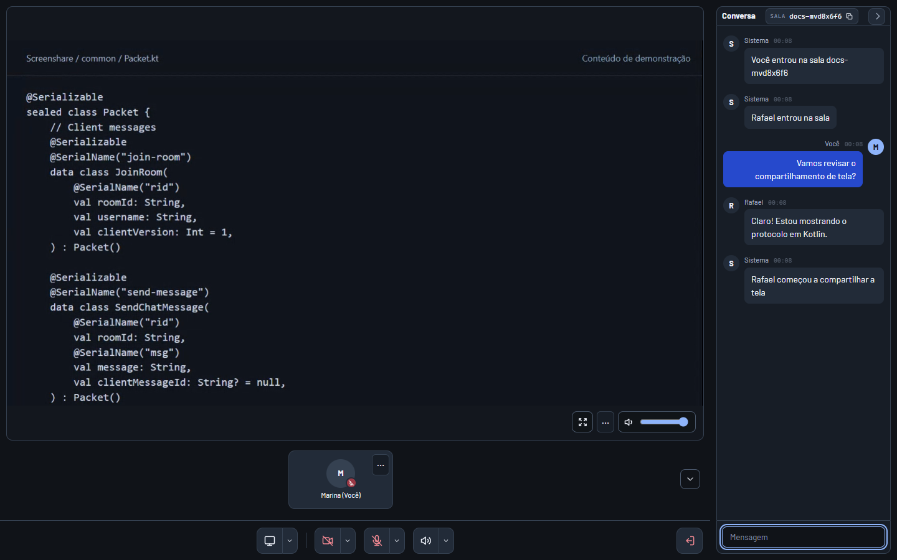
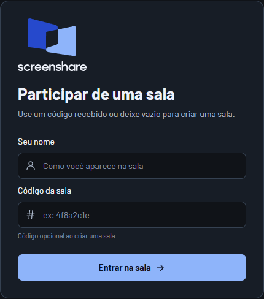
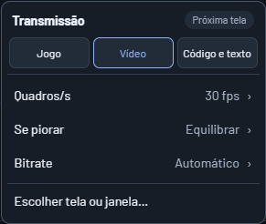
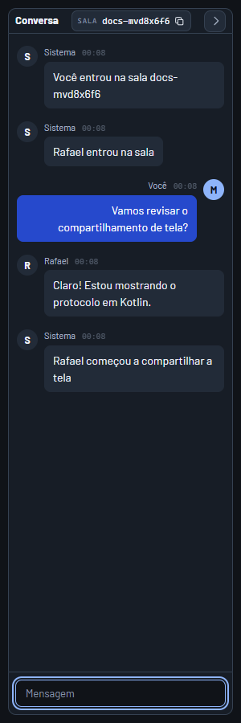
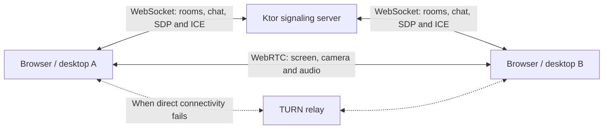

<div align="center">

<picture>
  <source media="(prefers-color-scheme: dark)" srcset="client/src/jsMain/resources/brand/screenshare-logo-on-dark.svg" />
  
</picture>

# Screenshare

**Share a screen. Talk it through. Keep everyone in the same room.**

Peer-to-peer screen sharing, voice, camera and chat in your browser — with native capture on Windows and macOS.

[](https://screen-share.fly.dev/)
[](https://github.com/RafaelrainBR/screenshare-kotlin-js/releases/latest)
[](LICENSE)

[Português](README.pt-BR.md) · [Features](#what-you-can-do) · [Screenshots](#see-it-in-action) · [Run locally](#run-locally) · [Documentation](docs/README.md)



</div>

## Get into a room

1. Open **[Screenshare in your browser](https://screen-share.fly.dev/)** or **[download the desktop app](https://github.com/RafaelrainBR/screenshare-kotlin-js/releases/latest)**.
2. Enter your name. Leave the room code empty to create a room, or paste a code to join one.
3. Copy the room code from the conversation header and send it to the people you want to join.
4. Share your screen, enable your microphone or camera, and chat.

No account is required. The interface is currently in Brazilian Portuguese. Anyone with the room code can join; use it with people you trust.

## What you can do

- **Share screens and windows**, with game, video, and code/text presets. Adjust frame rate (up to 60 fps), bitrate and the trade-off between sharpness and smoothness.
- **Talk and use your camera** independently of screen sharing. Choose devices, mute your microphone or output, and adjust another participant's volume.
- **Follow multiple streams** in a grid or focus on one with a preview rail. Hide the conversation when you need more space.
- **Chat in the room**, including earlier messages while the room remains active.
- **Use native desktop capture** with screen/window thumbnails, computer or application audio, tray controls, optional startup at login, and in-app updates for supported installations.
- **Host your own server**. Kotlin/Ktor handles rooms, text chat and WebRTC signaling; media uses a direct connection when possible, with TURN relay when needed.

Resolution, frame rate and audio availability depend on the source, browser, operating system, network and hardware. These are capture/encoder settings, not a performance guarantee.

### Browser or desktop?

| | Browser | Windows desktop | macOS desktop |
|---|---|---|---|
| Screen sharing, camera, voice and chat | Yes | Yes | Yes |
| Source selection | Browser picker | Native screens/windows and thumbnails | Native screens/windows and thumbnails |
| Shared audio | Browser/source dependent | Computer or selected application | Computer or selected application |
| Tray controls and startup at login | — | Yes | Yes |
| Distribution | Open the web app | x64 installer, MSI or portable EXE | Apple Silicon app archive and install script |

Desktop builds use the same Kotlin/JS client and rooms as the browser. Windows builds are unsigned; macOS builds use ad hoc signing without notarization. See [installation, permissions and platform limits](docs/usage.md).

## See it in action

Screenshots show the current browser client in a local demo room, with a real WebRTC screen stream and sample conversation. The shared content is this repository's Kotlin protocol source.

| Join or create a room | Tune your transmission |
|---|---|
|  |  |

<details>
<summary>Conversation sidebar</summary>



</details>

## Run locally

Install **JDK 21** (the build uses a Java 21 toolchain), then clone and run:

```bash
git clone https://github.com/RafaelrainBR/screenshare-kotlin-js.git
cd screenshare-kotlin-js
./gradlew :server-java:run
```

On Windows PowerShell, use `.\gradlew.bat :server-java:run`.

Open **[http://localhost:8080](http://localhost:8080)** in two tabs and join the same room. The task builds the browser client and serves it with the signaling server. The included Gradle wrapper manages Gradle and the Kotlin/JS Node/Yarn tools; the first build downloads dependencies. For screen sharing on another host, serve the app over HTTPS.

See [development and tests](docs/development.md) for build commands and desktop prerequisites; see [self-hosting](docs/self-hosting.md) for Docker, Fly.io and STUN/TURN configuration.

## How it works



| Module | Responsibility |
|---|---|
| [`client/`](client) | Kotlin/JS interface, WebRTC, screen sharing, camera and voice |
| [`common/`](common) | Kotlin Multiplatform packet types shared by JS and JVM |
| [`server/`](server) | Ktor/JVM signaling, room membership and in-memory chat history |
| [`server-java/`](server-java) | JVM entry point, fat JAR, Docker and Fly.io configuration |
| [`desktop-tauri/`](desktop-tauri) | Tauri shell, tray, updater and TypeScript media bridge |
| [`desktop-capture/`](desktop-capture) | Shared Rust capture: Windows DXGI/GDI/WASAPI and macOS ScreenCaptureKit/Core Audio |

The UI uses local CSS, JavaScript and Barlow fonts. Dependency versions live in [`libs.versions.toml`](libs.versions.toml), [`desktop-tauri/package.json`](desktop-tauri/package.json) and the Cargo manifests.

## Project status and contributing

Screenshare is under active development. Documentation describes the current source; the [latest desktop release](https://github.com/RafaelrainBR/screenshare-kotlin-js/releases/latest) may lag behind `master`. Release assets and changes are listed on [GitHub Releases](https://github.com/RafaelrainBR/screenshare-kotlin-js/releases).

Bug reports, platform testing and contributions are welcome. Start with [CONTRIBUTING.md](CONTRIBUTING.md), check [open issues](https://github.com/RafaelrainBR/screenshare-kotlin-js/issues), or read the [documentation index](docs/README.md).

Licensed under [MIT](LICENSE).
