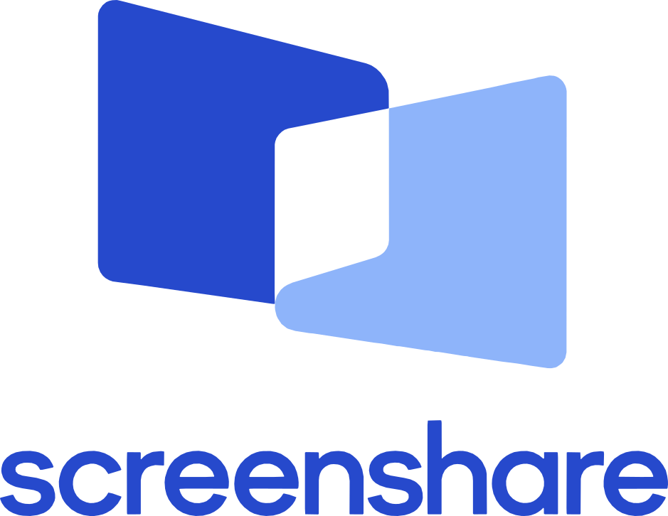
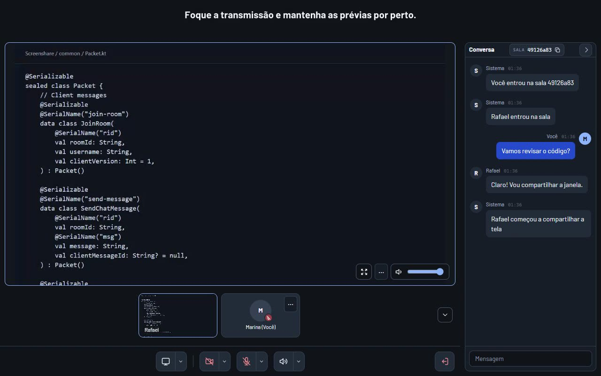
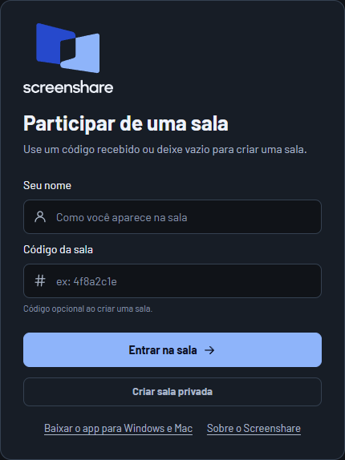
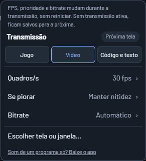
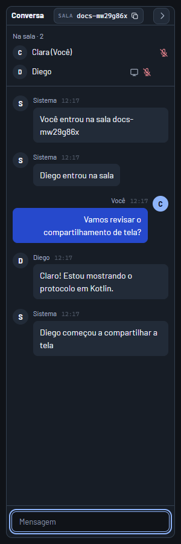
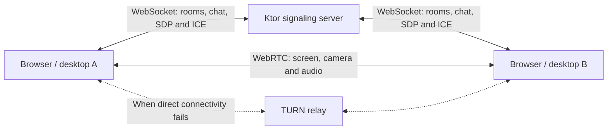

<div align="center">

<picture>
  <source media="(prefers-color-scheme: dark)" srcset="client/src/jsMain/resources/brand/screenshare-logo-on-dark.svg" />
  
</picture>

# Screenshare

**Share a screen. Talk it through. Keep everyone in the same room.**

Peer-to-peer screen sharing, voice, camera and chat in your browser, plus a native desktop app for Windows and macOS.

[](https://screen-share.fly.dev/)
[](https://github.com/RafaelrainBR/screenshare/releases/latest)
[](LICENSE)

[Português](README.pt-BR.md) · [Website](https://screen-share.fly.dev/about/en.html) · [Features](#what-you-can-do) · [Run locally](#run-locally) · [Documentation](docs/README.md)

<a href="https://screen-share.fly.dev/about/en.html#demo"></a>

</div>

## Get into a room

1. Open **[Screenshare in your browser](https://screen-share.fly.dev/)** or **[download the desktop app](https://screen-share.fly.dev/about/download-en.html)**.
2. Enter your name. Leave the room code empty to create a room, paste a code to join one, or choose **Criar sala privada** for a long code nobody can guess.
3. Click the room code in the conversation header to copy the room link, and send it to the people you want to join. The link opens the room in the browser; on Windows the page also offers to open it in the desktop app.
4. Share your screen, turn on your microphone or camera, and chat.

No account is required. The interface is in Brazilian Portuguese. Anyone with the room code or link can join; use it with people you trust.

## What you can do

- **Share screens and windows** with game, video and code/text presets. Adjust frame rate (up to 60 fps), bitrate and the trade-off between sharpness and smoothness; when a share hits its limit, one click lightens it.
- **Talk and use your camera** independently of screen sharing. Choose devices, mute your microphone or output, set each participant's volume, and reduce microphone noise in the browser.
- **Follow several streams** in a grid, or focus on one with a preview rail. Names stay on the tiles, any stream can pop out into a floating window, and the conversation hides when you need the space.
- **Chat and see who is in the room**, including earlier messages while the room stays active. A short tone plays when someone joins, leaves or starts sharing.
- **Get back quickly** with recent and favorite rooms on the join screen.
- **Use the native desktop app** (Rust and iced, no WebView): screen and window thumbnails, computer or single-application audio, H.264 hardware encoding with NVENC or Media Foundation on Windows, tray controls, optional startup at login and one-click updates.
- **Host your own server**. Kotlin/Ktor handles rooms, text chat and WebRTC signaling; media uses a direct connection when possible, with a TURN relay when needed.

Resolution, frame rate and audio availability depend on the source, browser, operating system, network and hardware. These are capture/encoder settings, not a performance guarantee.

### Browser or desktop?

| | Browser | Windows desktop | macOS desktop |
|---|---|---|---|
| Screen sharing, camera, voice and chat | Yes | Yes | Yes |
| Source selection | Browser picker | Native screens/windows with thumbnails | Native screens/windows with thumbnails |
| Shared audio | Browser/source dependent | Computer (call apps left out) or one application | Computer or one application (macOS 14.2+) |
| Tray, startup at login and in-app updates | — | Yes | Yes |
| Distribution | Open the web app | Per-user installer or portable EXE (x64) | Apple Silicon app with an install script |

The desktop app is a separate native client that joins the same rooms as the browser. Windows builds are unsigned; the macOS app is self-signed and not notarized. See [installation, permissions and platform limits](docs/usage.md).

### Privacy

Media goes directly between participants, or through a TURN relay when a direct connection fails. Chat and signaling pass through the server and live only in its memory. The hosted site and the released desktop app send error reports and anonymous usage statistics to Sentry: counts and durations in ranges, never your name, the room code, your IP address or what you share. Turn the statistics off with **Enviar estatísticas de uso anônimas** in the audio output menu (the arrow next to the speaker button); self-hosted and locally built copies send nothing.

## See it in action

**[Watch the short demo](https://screen-share.fly.dev/about/en.html#demo)** or [download the English-captioned MP4](https://screen-share.fly.dev/about/assets/demo-en.mp4). The recording shows a real local browser session; it does not demonstrate native audio or measure streaming performance.

Screenshots show the current browser client in a local demo room, with a real WebRTC screen stream and sample conversation. The shared content is this repository's Kotlin protocol source.

| Join or create a room | Tune your transmission |
|---|---|
|  |  |

<details>
<summary>Conversation sidebar</summary>



</details>

## Run locally

Install **JDK 21** (the build uses a Java 21 toolchain), then clone and run:

```bash
git clone https://github.com/RafaelrainBR/screenshare.git
cd screenshare
./gradlew :server-java:run
```

On Windows PowerShell, use `.\gradlew.bat :server-java:run`.

Open **[http://localhost:8080](http://localhost:8080)** in two tabs and join the same room. The task builds the browser client and serves it with the signaling server. The included Gradle wrapper manages Gradle and the Kotlin/JS Node/Yarn tools; the first build downloads dependencies. For screen sharing on another host, serve the app over HTTPS.

See [development and tests](docs/development.md) for build commands, the [desktop guide](desktop-native/README.md) for the native app, and [self-hosting](docs/self-hosting.md) for Docker, Fly.io and STUN/TURN configuration.

## How it works



| Module | Responsibility |
|---|---|
| [`client/`](client) | Kotlin/JS browser client: interface, WebRTC, screen sharing, camera and voice |
| [`common/`](common) | Kotlin Multiplatform packet types shared by JS and JVM |
| [`server/`](server) | Ktor/JVM signaling, room membership, in-memory chat history and the public site |
| [`server-java/`](server-java) | JVM entry point, fat JAR, Docker and Fly.io configuration |
| [`desktop-native/`](desktop-native) | Desktop app in Rust and iced: interface, tray, updater, WebRTC and encoders |
| [`desktop-capture/`](desktop-capture) | Rust capture shared by the desktop app: Windows DXGI/GDI/WASAPI and macOS ScreenCaptureKit/Core Audio |
| [`site/`](site) | Templates and copy for the public About and Downloads pages |

The browser and the desktop app are two clients of one protocol. The web UI uses local CSS, JavaScript and Barlow fonts. Dependency versions live in [`libs.versions.toml`](libs.versions.toml) and the Cargo manifests.

## Project status and contributing

Screenshare is under active development. Documentation describes the current source; the [latest desktop release](https://github.com/RafaelrainBR/screenshare/releases/latest) may lag behind `master`. Release assets and changes are listed on [GitHub Releases](https://github.com/RafaelrainBR/screenshare/releases).

Bug reports, platform testing and contributions are welcome. Start with [CONTRIBUTING.md](CONTRIBUTING.md), check [open issues](https://github.com/RafaelrainBR/screenshare/issues), or read the [documentation index](docs/README.md).

Licensed under [MIT](LICENSE).
