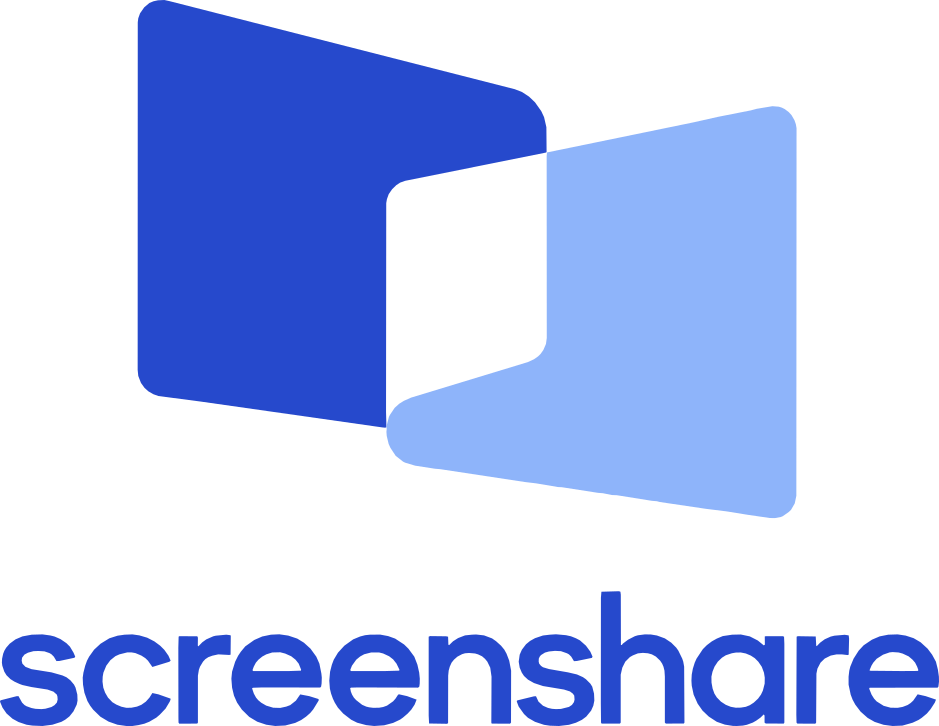
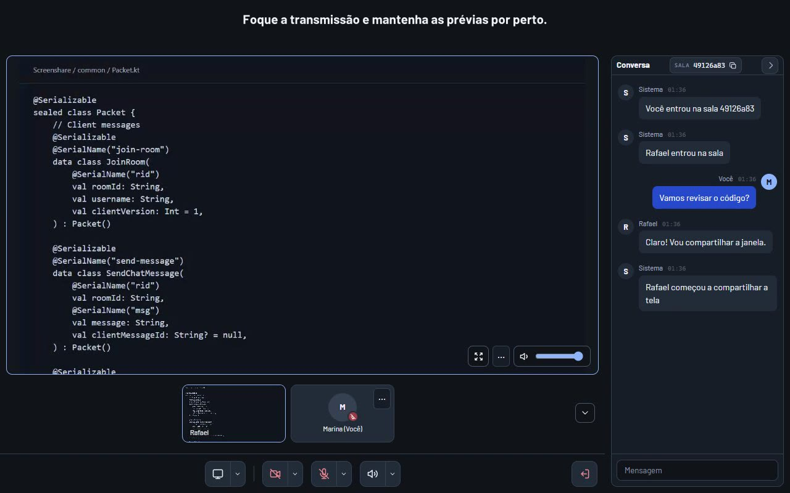

<div align="center">

<picture>
  <source media="(prefers-color-scheme: dark)" srcset="client/src/jsMain/resources/brand/screenshare-logo-on-dark.svg" />
  
</picture>

# Screenshare

**Compartilhe a tela e converse na mesma sala.**

Compartilhamento de tela, voz, câmera e chat pelo navegador ou pelo aplicativo para Windows e macOS.

**[Abrir no navegador](https://screen-share.fly.dev/)** · **[Baixar o desktop](https://github.com/RafaelrainBR/screenshare-kotlin-js/releases/latest)** · [Site e demonstração](https://screen-share.fly.dev/about) · [English](README.md)

<a href="https://screen-share.fly.dev/about#demo"></a>

</div>

## Experimente

Veja a **[demonstração curta](https://screen-share.fly.dev/about#demo)** ou [baixe o MP4 legendado](https://screen-share.fly.dev/about/assets/demo-pt.mp4). É uma sessão local real no navegador; não demonstra áudio nativo nem mede desempenho da transmissão.

1. Abra o [aplicativo web](https://screen-share.fly.dev/) ou instale a [versão desktop](https://github.com/RafaelrainBR/screenshare-kotlin-js/releases/latest).
2. Digite seu nome. Deixe o código em branco para criar uma sala ou cole o código de uma sala existente.
3. Copie o código no cabeçalho da conversa e envie às pessoas que vão participar.
4. Compartilhe a tela, ative o microfone ou a câmera e converse.

A interface está em português e não exige conta. Quem tiver o código pode entrar na sala; compartilhe-o com pessoas de confiança.

## Recursos

- **Tela e janelas:** perfis para jogo, vídeo e código/texto, com ajuste de quadros por segundo, bitrate e prioridade entre nitidez e fluidez.
- **Voz e câmera:** controles independentes, seleção de dispositivos, silenciamento de entrada/saída e volume por participante.
- **Várias transmissões:** grade ou tela em foco com faixa de prévias; conversa lateral que pode ser ocultada.
- **Chat:** mensagens da sala, incluindo o histórico disponível enquanto ela continua ativa.
- **Desktop:** captura nativa com miniaturas, áudio do computador ou de um aplicativo, controles na bandeja, início opcional com o sistema e atualização integrada nas instalações compatíveis.
- **Hospedagem própria:** servidor Kotlin/Ktor para salas, chat e sinalização. A mídia usa WebRTC direto quando possível e relay TURN quando necessário.

Resolução, áudio e desempenho dependem do sistema, navegador, fonte, rede e hardware. O ajuste permite até 60 fps, sem garantir essa taxa em todos os cenários.

## Navegador ou desktop?

O navegador não exige instalação e usa seu próprio seletor de compartilhamento. A disponibilidade de áudio depende da fonte escolhida e do suporte da plataforma.

O desktop oferece seleção nativa de telas/janelas e áudio por aplicativo. Os downloads incluem **Windows x64** (instalador, MSI e EXE portátil) e **macOS Apple Silicon** (arquivo do app e script de instalação). As versões Windows não têm assinatura de código; as versões macOS usam assinatura ad hoc, sem notarização. O EXE portátil não se atualiza sozinho.

Leia o [guia de instalação, permissões e limitações](docs/usage.md) (em inglês). No macOS, o guia explica também como recuperar a permissão de captura após uma atualização.

## Rodar localmente

Com o **JDK 21** instalado:

```bash
git clone https://github.com/RafaelrainBR/screenshare-kotlin-js.git
cd screenshare-kotlin-js
./gradlew :server-java:run
```

No PowerShell, use `.\gradlew.bat :server-java:run`.

Abra **[http://localhost:8080](http://localhost:8080)** em duas abas e entre na mesma sala. O comando compila o cliente e inicia o servidor; o Gradle Wrapper baixa as ferramentas e dependências necessárias. Fora de `localhost`, sirva a aplicação por HTTPS para usar a captura de tela.

## Documentação e contribuição

A documentação técnica está em inglês para facilitar a colaboração:

- [Índice da documentação](docs/README.md)
- [Uso, instalação e solução de problemas](docs/usage.md)
- [Desenvolvimento e testes](docs/development.md)
- [Hospedagem própria, Docker e STUN/TURN](docs/self-hosting.md)
- [Desenvolvimento e releases do desktop](desktop-native/README.md)
- [Como contribuir](CONTRIBUTING.md)

O projeto está em desenvolvimento ativo. A documentação acompanha o código atual; os aplicativos publicados podem estar atrás da `master`. Consulte as [releases](https://github.com/RafaelrainBR/screenshare-kotlin-js/releases) e [issues](https://github.com/RafaelrainBR/screenshare-kotlin-js/issues) para acompanhar mudanças e reportar problemas.

As capturas mostram o cliente web atual numa sala local de demonstração, com transmissão WebRTC real e uma conversa de exemplo. O código compartilhado pertence a este repositório.

Licença [MIT](LICENSE).
