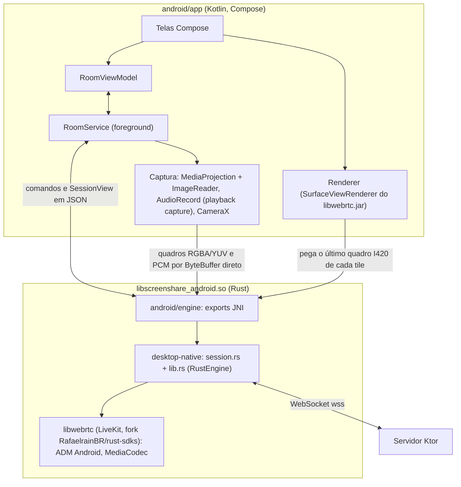

# App Android — plano

Data: 07/11/2026. Base: `master` em `7783765` (desktop native-v1.0.2).

## Objetivo

Um app Android que faz o que o site no Chrome do celular não faz:

1. **Compartilhar a tela do celular**, com o áudio dos apps (o Chrome no Android não tem `getDisplayMedia`).
2. **Ficar na sala com a tela apagada ou em outro app**: voz e transmissão continuam, com uma notificação para mutar, parar e sair.
3. **Assistir numa janela flutuante (PiP)** por cima de um jogo.
4. **Abrir o link da sala direto no app** (o mesmo `https://screen-share.fly.dev/?roomId=…` da web e do desktop).

Ele entra nas mesmas salas que a web e o desktop, sem mudar o protocolo nem o servidor de sinalização.

## Decisões do usuário (07/11/2026)

- Só Android; iOS fica de fora (licença da Apple).
- Interface em **Jetpack Compose** (caminho "C" da análise).
- **Android 10 (API 29) no mínimo**: é a primeira versão que deixa capturar o áudio de outros apps.
- Distribuição: **primeiro GitHub Releases**; a Play Store vem depois que estabilizar.
- O plano vem completo antes do código.

## Decisão de arquitetura: UI em Compose sobre o motor Rust do desktop

O caminho C foi apresentado como "Kotlin com o WebRTC oficial do Android". A pesquisa para este plano mudou a peça de baixo, mantendo a de cima: **a interface é Compose, e o motor é o mesmo `desktop-native` em Rust**, compilado para Android e chamado por JNI.

### Por que

| Ponto | Motor Rust do desktop (escolhido) | SDK Java do WebRTC (`io.github.webrtc-sdk:android`) |
|---|---|---|
| Protocolo, negociação, reconexão, regras de qualidade, presets | **Os mesmos** do desktop (`session.rs`, `lib.rs`, `quality.rs`, `share.rs`), com os testes que já existem | Terceira reimplementação. Hoje mudar uma regra já exige mudar web e nativo; seriam três |
| Áudio do compartilhamento | **Faixa separada** `screen-audio` no stream `screen`, igual ao desktop (`NativeAudioSource`). Quem assiste tem volume próprio para a tela | O SDK não cria faixa de áudio própria. O padrão (LiveKit, 100ms) é **misturar no microfone**: quem assiste ouve o jogo no volume da voz, mutar o microfone some com o jogo, e a supressão de ruído da voz estraga a música |
| Codificação por hardware | `CreateAndroidVideoEncoderFactory` (MediaCodec) já está no `webrtc-sys` do fork (`video_encoder_factory.cpp`), e a decodificação também | Nativo |
| Captura de tela | Quadros RGBA do `ImageReader` passam por JNI e viram I420 (libyuv) — uma cópia e uma conversão por quadro | Textura direto para o encoder, sem cópia |
| Binários | libwebrtc pronto da LiveKit para `android-arm64`, `android-arm` e `android-x64` na mesma tag `webrtc-89d790b` que o desktop usa (conferido nos assets da release) | AAR pronto |
| Ponte | JNI fino: o motor já recebe comandos JSON e devolve eventos JSON (herança do Tauri) | Nenhuma |

A cópia na captura é o único ponto em que o SDK Java ganha. Em 720p a 30 qps são ~3,7 MB por quadro de RGBA e uma conversão NEON de poucos ms: a F0 mede se isso pesa num celular mediano. Em troca, o Android ganha paridade de comportamento com o desktop e o áudio da tela do jeito certo. Um precedente: o motor já teve uma ponte JNI (removida na F1 do desktop, consultável no branch `codex/pause-native-gpui-20261005`, `EventSink::Jvm`).

**Saída de emergência:** se a F0 reprovar o motor Rust no Android (ADM, encoder ou custo de captura), o plano cai para o SDK Java com o áudio misturado no microfone. A UI em Compose não muda; só a camada `engine` troca.

## Escopo

### Na primeira versão estável (android-v1.0.0)

- Entrar numa sala: nome, código, criar sala privada, salas recentes e favoritas.
- Ouvir e falar: microfone liga e desliga, saída alto-falante ou fone, volume e "Silenciar para você" por pessoa, anel de quem está falando, sons de entrar, sair e compartilhar (com opção de desligar).
- Assistir: grade e foco, nomes nos tiles, volume do áudio da tela, PiP, "Por que está travando?" do lado de quem assiste.
- Compartilhar a tela: presets Jogo, Vídeo e Texto (os de `share.rs`), 720p ou 1080p, 30 ou 60 qps, áudio do celular ligado ou desligado, compartilhar só um app (Android 14+), parar pela notificação, selo "Seu celular está no limite".
- Segundo plano: serviço em primeiro plano com notificação (mutar, parar compartilhamento, sair).
- Link da sala abre o app (App Links).
- Câmera frontal ou traseira.
- Conversa (chat) — por último, como no resto do projeto.
- Atualização dentro do app a partir do GitHub Releases, erros e estatísticas anônimas no Sentry com a mesma chave de desligar.

### Fora de escopo (por enquanto)

- iOS, tablets com layout próprio (o app funciona, mas sem desenho específico), Android TV.
- Sobreposição flutuante por cima do jogo com botão de microfone (estilo Discord): pede `SYSTEM_ALERT_WINDOW`, que a Play restringe. Fica como ideia.
- Mudanças de protocolo. A única ideia que pediria uma é dizer a quem assiste que o compartilhador está num celular (ver "Limitações conhecidas").

## Como as peças se encaixam



### Pastas

```
android/                      build Gradle próprio, fora do build da web/servidor
  settings.gradle.kts
  gradle/libs.versions.toml   catálogo próprio (AGP, Compose, CameraX, Sentry)
  app/                        o app (Kotlin, Compose)
  engine/                     crate Rust cdylib "screenshare_android": só a ponte JNI
    Cargo.toml                depende de ../../desktop-native por path
    Cargo.lock
    rust-toolchain.toml       igual ao do desktop
desktop-native/               ganha a plataforma Android (F1); o app desktop não muda
```

O Android **não depende de `common/`**: o protocolo vive em `session.rs`. Por isso o build é separado, e a web e o servidor não ganham AGP no caminho.

## Detalhes técnicos

### Ponte JNI (`android/engine`)

- Crate `cdylib` com o crate `jni`. Exporta cerca de oito funções:
  - `start(endpoint, room, name, config)`: cria os canais e o `SessionView` e roda `run_controlled_with_ui` numa thread, como o `main.rs` do desktop faz;
  - `stop()`;
  - `command(json)`: chat, microfone, saída, volume por pessoa, preset, `GetScreenQuality` e afins;
  - `view()`: devolve o `SessionView` em JSON só quando ele mudou desde a última leitura (o Rust guarda o último JSON entregue; o campo `generation` é da reconexão, não serve para isso). A tela pergunta a cada 100 ms, como o tick do iced, só enquanto está visível. O serviço pergunta a cada 1 s, para atualizar a notificação. O `SessionView` ganha `Serialize`;
  - `pushScreenFrame(buffer, width, height, rowStride, timestampNs)`;
  - `pushScreenAudio(buffer, frames)`;
  - `pushCameraFrame(y, u, v, strides…)`;
  - `takeFrame(peer, track, yBuf, uBuf, vBuf)`: copia o último `VideoFrameSnapshot` para buffers diretos do Kotlin.
- Pânico do Rust nunca atravessa o JNI: cada export roda em `catch_unwind` e devolve um erro.
- O Rust confere tamanho e stride de cada buffer recebido (largura × altura × 4 ≤ capacidade, por exemplo) antes de ler. Os comandos passam pelos limites que o motor já tem (`MAX_COMMAND`, `MAX_SDP` etc.).
- Nenhum export bloqueia a thread principal: `command` só põe na fila do motor, e `view` segura o mutex o tempo de serializar.
- `initialize_android_context(jvm, context)` do `libwebrtc` roda no `JNI_OnLoad`/`init`. Sem ele o ADM do Android não sobe.
- O `libwebrtc.jar` (classes `livekit.org.webrtc.*`, que o `webrtc-sys` copia no build) entra no app. O ADM e os codecs de hardware usam essas classes.

### Mudanças no `desktop-native` (F1)

O app desktop não pode mudar de comportamento. As mudanças são:

- **Dependências por plataforma.** `iced`, `tray-icon`, `image`, `reqwest` (`native-tls`), o `sentry` com `minidump` e o `desktop-capture` passam para `[target.'cfg(not(target_os = "android"))'.dependencies]`. Os módulos que usam o `desktop-capture` (`sources.rs`, o `capture` do Windows e do macOS) também ficam fora do Android. No Android:
  - `sentry` sem features padrão (o `transport` padrão traz `reqwest` com `native-tls`), com `backtrace`, `contexts`, `panic`, `logs`, `ureq` e `rustls`, sem OpenSSL;
  - `tokio-tungstenite` com `rustls-tls-webpki-roots`. O `rustls-native-certs` não lê a loja do Android. O atalho é aceito: um servidor próprio com CA privada não conecta.
- **Captura e câmera Android.** O `capture.rs` e o `camera` ganham `capture_android.rs` e `camera_android.rs`: em vez de capturar, recebem os quadros e o PCM que o JNI empurra. O `ShareSource` ganha uma variante para esses quadros (no lugar de tela ou janela), e o `audio_mode` aceita só `None` e `Computer`. A conversão de quadros usa o `yuv_helper` do `libwebrtc` (`abgr_to_i420`: o RGBA_8888 do Android é "ABGR" na convenção do libyuv).
- **Nome do aparelho.** `quality.rs`: "PC" vira "celular" nas frases sobre o próprio aparelho (`label` e `explanation`), e `metrics.rs` manda `platform = native-android`.
- **Comando novo `SetVideoReception { enabled }`.** Põe os transceivers de vídeo recebidos em `inactive` ou `recvonly`, como o `setVideoReception` da web. Serve para o app em segundo plano sem PiP e para a economia de dados, e o desktop pode usar ao minimizar.
- **CI.** O `native-check.yml` ganha um `cargo check --target aarch64-linux-android` (NDK do runner), para o desktop nunca quebrar o Android sem ninguém ver.

### Captura de tela

- **Consentimento.** `MediaProjectionManager.createScreenCaptureIntent()`. No Android 14+ usa `MediaProjectionConfig.createConfigForUserChoice()`, para a pessoa poder escolher "um app". O consentimento vale por sessão, e o token é de uso único (regra do Android 14).
- **Captura.** `VirtualDisplay` no tamanho do preset: o lado menor em 720 ou 1080, mantendo a proporção da tela. Ele alimenta um `ImageReader` RGBA_8888 com 3 imagens, numa thread própria. Cada `acquireLatestImage` vai por JNI ao `NativeVideoSource`. O bitrate é o `share_bitrate(profile, altura)` do desktop.
- **Rotação.** Ao girar, `virtualDisplay.resize` e um `ImageReader` novo. No Android 14+, `onCapturedContentResize` dá o tamanho do app compartilhado.
- **Ordem exigida pelo Android 14+.** Primeiro o consentimento, depois o serviço com o tipo `mediaProjection`, e só então o `getMediaProjection`.
- **Quando o sistema encerra o share.** O Android encerra a projeção ao bloquear a tela, quando outro app começa uma projeção ou quando o processo morre. O `MediaProjection.Callback.onStop` para a captura, manda `stop-screen-share` pelo `StopScreen` e mostra "O compartilhamento parou porque a tela foi bloqueada". Não é a reconexão: a reconexão mantém a captura, o bloqueio não.
- **Conteúdo protegido.** Apps com `FLAG_SECURE` (bancos, alguns streamings) saem pretos. É do sistema; o app avisa uma vez.
- **Codec.** H264 primeiro (`preferred_video_codecs(…, h264_first = true)`): é o que todo celular codifica por hardware.
- **Calor.** O Android informa quando o aparelho esquenta (`PowerManager.getCurrentThermalStatus`, API 29). A partir de `THERMAL_STATUS_SEVERE`, o selo vira "Seu celular está esquentando", com o mesmo botão de preset mais leve que o limite de CPU já tem. Só quem compartilha vê o aviso. Para a sala continua valendo o que o codificador relata: o celular quente que ainda dá conta não aparece como "no limite" para os outros.
- **Limite de codificadores.** A malha manda um vídeo por pessoa, e o celular abre um codificador por pessoa (até 4, o `MAX_PEERS`). Muitos celulares têm poucas instâncias de MediaCodec; quando faltam, o libwebrtc cai para software, que esquenta. A F0 mede com 1, 2 e 4 pessoas assistindo. Se precisar, o preset do celular baixa a resolução a partir da terceira pessoa (regra só do Android, em `share.rs`).

### Áudio do celular no compartilhamento

- `AudioRecord` com `AudioPlaybackCaptureConfiguration(projection)`, para os usos `USAGE_MEDIA`, `USAGE_GAME` e `USAGE_UNKNOWN`, a 48 kHz estéreo PCM 16 bits, lido em blocos de 10 ms (480 quadros). Vai ao `NativeAudioSource` da faixa `screen-audio`, como o modo "Computador" do desktop.
- **A voz da sala nunca vaza para o share.** O próprio app toca as vozes como `USAGE_VOICE_COMMUNICATION`, que a captura não pega. O mesmo vale para outras ligações (WhatsApp etc.). É a regra do desktop: "tudo menos apps de chamada".
- **Apps que recusam a captura.** Cada app pode desligar a captura do seu áudio (`allowAudioPlaybackCapture`). Aí não sai som: o share mostra "Este app não permite capturar o áudio".
- **Jogo no alto-falante com o microfone ligado.** O cancelamento de eco só conhece o som que o próprio app toca. O som do jogo saindo pelo alto-falante entra no microfone, e quem assiste ouve o jogo duas vezes, com atraso. Compartilhando com áudio, microfone ligado e sem fone, o app avisa: "Use fone para o som do jogo não vazar no microfone".
- **Permissões.** Pede `RECORD_AUDIO`, que a captura de reprodução exige. Para funcionar com o app em segundo plano, o serviço também precisa do tipo `microphone` ativo (documentação da LiveKit para o `ScreenAudioCapturer`), mesmo com o microfone mutado. Não muda o modo de áudio: a captura de reprodução não precisa do modo de ligação.

### Voz e rotas de áudio

Em celular, o modo do sistema muda a qualidade do som. Por isso o app troca de modo conforme o microfone:

| Situação | Modo | Por quê |
|---|---|---|
| Microfone desligado (o padrão ao entrar) | `MODE_NORMAL`, volume de mídia | O fone Bluetooth fica em A2DP, com som de música. Os botões de volume mexem na mídia |
| Microfone ligado | `MODE_IN_COMMUNICATION` | Precisa disso para o cancelamento de eco por hardware. No Bluetooth vira HFP (mono, pior); o app avisa uma vez: "Com o microfone ligado, o fone Bluetooth fica com som de ligação" |

- **Mutado é microfone fechado**, sem o indicador verde do Android: o motor já faz isso no desktop com `set_adm_recording_enabled`. Ele só abre ao ligar.
- **Sem foco de áudio que abaixe os outros apps.** O app não pede foco de áudio que pause ou abaixe ("duck") o jogo. É o mesmo cuidado do problema de ducking que o desktop corrigiu no Windows.
- **Saída.** Sem fone, o padrão é o alto-falante, como no Discord: `setCommunicationDevice` no API 31+ e `isSpeakerphoneOn` no 29 e 30. Com fone com fio ou Bluetooth, o fone. O botão de saída alterna.
- **Ligação telefônica.** O Android tira o microfone durante a ligação. O app mostra "Microfone pausado durante a ligação" e volta ao estado anterior depois.
- **Risco a medir na F0.** O `CreateAndroidAudioDeviceModule(kPlatformDefaultAudio)` do `webrtc-sys` não deixa escolher os `AudioAttributes` do ADM, nem a saída em estéreo. A tela de um PC chega em Opus estéreo (`OPUS_EXTRA` do `share.rs`); um ADM mono toca o jogo em mono. Se o modo "mídia" ou o estéreo não funcionarem, entra um patch pequeno no fork `RafaelrainBR/rust-sdks`: aceitar um `JavaAudioDeviceModule` criado no Kotlin, com atributos e estéreo próprios, pelo `getNativeAudioDeviceModulePointer()`.

### Vídeo recebido

- O `render.rs` já guarda o último quadro I420 de cada faixa. Cada tile visível pede o quadro novo a cada vsync (`Choreographer`) e o entrega a um `livekit.org.webrtc.SurfaceViewRenderer` do `libwebrtc.jar` como `JavaI420Buffer`. É o renderizador GL que o WebRTC já testa. Se ele não funcionar fora do SDK Java, entra um `GLSurfaceView` com shader YUV próprio (~200 linhas).
- Tile fora da tela não pede quadro.
- **Em segundo plano sem PiP**, o app envia `SetVideoReception(false)`: não baixa vídeo e só fica o áudio.

### Câmera

- CameraX `ImageAnalysis` (YUV_420_888, alvo 720p, 30 qps), frontal ou traseira. Respeita os strides de pixel e de linha. Vai ao `camera_android.rs` como I420, e a ordem tela antes de câmera é a mesma do desktop (`attach_camera`).
- Serviço com o tipo `camera` enquanto ligada.

### Serviço em primeiro plano e ciclo de vida

- **Um `RoomService`** vive enquanto a pessoa estiver na sala e é dono do motor. A `Activity` só desenha.
- **Os tipos do serviço acompanham o uso**, pelo `startForeground(…, tipos)`:
  - `mediaPlayback`: base, para ouvir e assistir;
  - `microphone`: desde a entrada na sala, se `RECORD_AUDIO` já foi concedida, mesmo mutado. O Android não deixa acrescentar o tipo `microphone` com o app em segundo plano (regra do "while-in-use"), e sem ele o "Desmutar" da notificação não funcionaria. Declarar o tipo não abre o microfone;
  - `camera`: com a câmera ligada;
  - `mediaProjection`: compartilhando.

  Cada tipo pede a permissão `FOREGROUND_SERVICE_*` correspondente. Câmera e compartilhamento só começam pela tela do app, que está na frente nessa hora.
- **Notificação permanente**: "Na sala · 3 pessoas", com Mutar/Desmutar, Parar compartilhamento e Sair. No Android 13+ o app pede `POST_NOTIFICATIONS`; sem ela o serviço roda do mesmo jeito.
- **Wi-Fi.** O app segura uma `WifiLock` de baixa latência enquanto está na sala: a economia de energia do Wi-Fi atrasa áudio e vídeo.
- **Tela apagada.** O servidor derruba o WebSocket sem resposta ao ping em 10 s, e o serviço em primeiro plano não impede a CPU de dormir. Com som tocando o próprio áudio do sistema a mantém acordada, mas numa sala em silêncio pode não manter. O app segura uma `PARTIAL_WAKE_LOCK` só enquanto está na sala; a F0 mede o custo de bateria com a tela apagada.
- **Fabricantes que matam apps** (Xiaomi, Samsung e outros). Se o serviço morrer, o app explica na volta como liberar a bateria, com link para dontkillmyapp.com.

### Rede e reconexão

- O `session.rs` já reconecta com espera de 1, 2, 4, 8 e 15 s e descarta a geração antiga. O celular troca de Wi-Fi para 4G com frequência, então o ICE restart que o motor já faz em `failed` precisa ser testado nessa troca.
- **Compartilhamento durante a reconexão.** No desktop, depois de reconectar, a mídia só volta por ação explícita (teste `ui_reconnect_discards_old_generation_and_requires_explicit_media_restart`). No Android, refazer o share pediria um consentimento novo. Então a captura fica viva por até 60 s durante a reconexão e aparece "Voltar a compartilhar" com um toque, sem pedir permissão de novo. Passados 60 s, a captura para.
- **Economia de dados** (opção, desligada por padrão). O app põe `b=AS` nas faixas de vídeo das descrições que ele envia. Quem compartilha respeita o teto **só para esse celular**: na malha cada pessoa tem o próprio codificador, então ninguém mais perde qualidade. Não muda o protocolo. A F4 confere se o libwebrtc honra o `b=AS` remoto na versão em uso.

### Link da sala

- **App Links.** `intent-filter` com `autoVerify` para `https://screen-share.fly.dev/`, só a raiz (`android:path="/"`, para `/about` e `/download` continuarem no navegador). O servidor passa a servir `/.well-known/assetlinks.json` com o SHA-256 da chave de release, por uma rota própria no `Application.kt`. Ele lê o arquivo de `server/src/jvmMain/resources/assetlinks.json`, e não do `static/`: essa pasta é gerada a partir do build do cliente e está no `.gitignore`. O link de sempre abre o app quando ele está instalado e o site quando não está. É a decisão de "um só link".
- **Link nunca entra sozinho.** Abre a tela Entrar com o código preenchido, e a pessoa confirma. Um link recebido de qualquer lugar não deve pôr ninguém numa sala, nem com o microfone.
- **Web no Android.** O botão de compartilhar tela hoje não funciona no Chrome do celular. Ele passa a mostrar "Para compartilhar a tela do celular, use o app Android", com o link de download.

### Interface

- **Visual.** O mesmo do site e do desktop: escuro, tokens de cor do `ui.css`/`ui/theme.rs` e fonte Barlow. Material 3 só por baixo, com o tema da marca. Textos em pt-BR, iguais aos da web e do desktop. O ícone de sair é a seta (decisão do redesign).
- **Telas:**
  1. **Entrar**: nome, código, "Entrar na sala", "Criar sala privada", recentes e favoritas.
  2. **Sala**: palco com grade e foco, e dock embaixo com microfone, compartilhar, câmera, saída, sair e "mais" (pessoas, conversa, ajustes). O código da sala no topo abre a folha de compartilhamento do Android, que é o jeito do celular de mandar o link pelo WhatsApp. Na web, isso é copiar o link.
  3. **Compartilhar** (folha que sobe): preset, qualidade, "Incluir o áudio do celular" e o botão que abre o consentimento do sistema. Lembra a última escolha ("compartilhar de novo"). Nos dados móveis, avisa quanto cada pessoa assistindo gasta da franquia, pelo bitrate do preset ("cerca de 20 MB por minuto por pessoa").
  4. **Pessoas**: volume e "Silenciar para você" por pessoa, e o selo de qualidade.
  5. **Conversa**.
  6. **Ajustes**: nome, sons, estatísticas anônimas, economia de dados, versão e atualização, enviar feedback.
- **PiP.** No API 31+ entra sozinho (`setAutoEnterEnabled`) ao sair do app assistindo uma tela; no 29 e 30, pelo `onUserLeaveHint`. Mostra o vídeo em foco e tem a ação de mutar.
- **Acessibilidade.** Rótulos no TalkBack e alvos de toque de 48 dp. O app é usável em retrato e paisagem.

### Telemetria

- **Projeto próprio no Sentry, `screenshare-android`**, criado pelo agente. Crashes de Java e do NDK não se misturam com os do desktop. O DSN vai para um secret do CI.
- **Erros do Kotlin, ANRs e crashes nativos** (Rust e C++): `sentry-android` com a integração NDK.
- **Erros e métricas do motor** (`metrics.rs`, `session.rs`): o `sentry` do Rust, no mesmo projeto, com a tag `platform = native-android`. As consultas das métricas passam a incluir esse projeto.
- **Mesmos eventos e faixas do desenho de métricas** (room_joined, share_started etc.). Nunca vão nome, sala, IP ou o que se compartilha. O que é só do Android vira `feature_used`, como `pip`, `data_saver`, `share_single_app` e `share_audio_blocked`.
- **"Enviar estatísticas de uso anônimas"** desliga as métricas nos dois SDKs; os erros continuam, como no desktop.
- **Sem DSN, nada é enviado.** Build local e de PR não têm DSN; o DSN vem de um secret no CI.

### Atualização (GitHub Releases)

- **Tags e releases.** Tag `android-vX.Y.Z` (beta: `android-vX.Y.Z-rc.N`). O `versionCode` é X·1000000 + Y·10000 + Z·100 + N; a versão final usa 99. Assim cada rc instala por cima da anterior, e a final por cima de todas. O release sai **sempre com `--latest=false`**: o "latest" é do desktop, e os apps Tauri antigos leem `releases/latest/download/latest.json`.
- **Updater no app.** Lista os releases, pega o maior `android-v*` sem sufixo, baixa o APK, confere o `SHA256SUMS` e abre o instalador do sistema. Usa `REQUEST_INSTALL_PACKAGES`, que sai na versão da Play. Na primeira atualização o Android pede para liberar "instalar apps desconhecidos" para o Screenshare; o app explica antes. O Android só aceita a atualização assinada com a mesma chave. Quem está numa rc atualiza à mão, como no desktop.
- **Regra dos 50 releases.** O updater do desktop lê só os 50 releases mais recentes (`per_page=50`), e versões instaladas não mudam: o `native-v*` mais novo precisa estar sempre entre os 50. Hoje há 47 releases. Por isso:
  - as betas do Android são artefatos do CI ou pre-releases apagados quando sai a versão final;
  - o desktop ganha paginação na próxima versão, para as instalações futuras;
  - o updater do Android já pede `per_page=100` e pagina.
- **Obtainium** funciona sem nada a mais, para quem preferir.

### Build, CI e release

- Gradle com AGP 9.x (Kotlin embutido), Kotlin 2.4 com o plugin do Compose da mesma versão, compileSdk e targetSdk 36, minSdk 29. A F0 confere as versões estáveis do dia.
- **Rust pelo `cargo-ndk`**, numa task `Exec` do Gradle antes do `merge…JniLibs`. ABIs:
  - release: `arm64-v8a` e `armeabi-v7a` (os baratos de 32 bits ainda existem no Brasil);
  - debug: também `x86_64`, para o emulador.

  Se o APK universal passar de ~60 MB, sai um APK por ABI.
- **Cache no CI.** O `webrtc-sys` baixa o libwebrtc pronto de cada ABI. O CI guarda esse download e o `target/` com o Swatinem e a chave `android`, como a `native` do desktop.
- **ktlint** no build do `android/`, na mesma versão do resto do repositório.
- **R8.** Regras de manter (`-keep`) para `livekit.org.webrtc.**` e para toda classe ou método que o Rust chama por JNI. Sem elas, o R8 remove o que o código nativo procura pelo nome, e o release quebra mesmo com o debug funcionando. O `android-check.yml` monta também o release (minificado) para pegar isso.
- **Páginas de 16 KB.** A `.so` é ligada com `-Wl,-z,max-page-size=16384`, e o CI confere o alinhamento (`zipalign -c -P 16`). Aparelhos com páginas de 16 KB não carregam bibliotecas desalinhadas, e a Play exige isso para o targetSdk 35+.
- **Servidor configurável só no build de debug** (para testes locais). O `endpoint_allowed` do motor só aceita `ws://` em localhost, então no emulador o teste usa `adb reverse tcp:8080 tcp:8080` e `ws://localhost:8080/`.
- **Workflows:**
  - `android-check.yml`: em PR que toca `android/**` ou `desktop-native/**`, monta o APK debug e roda os testes do Kotlin e o `cargo test` do motor;
  - `release-android.yml`: com a tag, assina, gera o `SHA256SUMS`, sobe o mapping do R8 e os símbolos nativos para o Sentry, e publica com as notas da tag anotada (pt-BR, como `native-v*`).
- **Chave de assinatura** (`.jks`) em secrets (`ANDROID_KEYSTORE`, senhas). A chave **não pode se perder**: sem ela, quem instalou não recebe mais atualização. Fica também uma cópia fora do GitHub, com o usuário.
- **Windows local.** O `webrtc-sys` acha o NDK do Windows (`windows-x86_64`). Valem os cuidados de MAX_PATH do desktop (`CARGO_TARGET_DIR` curto). A máquina ainda não tem o Android SDK, o NDK nem o adb: a F0 instala.

### Distribuição e verificação do desenvolvedor

- **Desde 30/09/2026 o Brasil exige desenvolvedor verificado**, e não só na Play. Sem registro, o APK só instala pelo "fluxo avançado", com 24 h de espera, ou pelo adb.
  - A conta gratuita de distribuição limitada não serve: chega a no máximo 20 aparelhos.
  - Antes do primeiro release público, o usuário precisa da conta completa do Android Developer Console: US$ 25 uma vez, com documento. Lá ele registra o pacote e a chave de assinatura. A proposta de pacote é `com.rafaelrain.screenshare`, o `group` do Gradle; ele não muda depois de publicado.
- **A Play depois (F7).** O AAB vai com a **mesma chave**: no Play App Signing, "usar a chave existente". Assim quem instalou pelo GitHub atualiza pela Play e vice-versa. O build da Play não tem o updater próprio nem `REQUEST_INSTALL_PACKAGES`. Também entram a declaração dos tipos do serviço em primeiro plano (`mediaProjection`, `microphone`, `camera`, `mediaPlayback`) com vídeo, o formulário de segurança de dados e uma página de privacidade no site.

## Compatibilidade

- **Protocolo e servidor.** Nada muda no protocolo. O app fala `clientVersion` 4 pelo `session.rs`, então web, desktop e Tauri antigo veem o celular como mais um cliente nativo. A única mudança no servidor é a rota que serve o `assetlinks.json`.
- **Release "latest".** Fica sempre com o desktop, porque os apps Tauri antigos dependem dele.
- **Janela de 50 releases.** Ver "Atualização".
- **Desktop.** As mudanças da F1 são restritas por `cfg`, passam no `cargo test` do desktop e vão num PR separado. A paginação do updater sai na versão seguinte do desktop.

## Fases

Cada fase é um ou mais PRs no `master` (como o desktop desde a 1.0.0). O app só fica público depois da F3; antes disso, só APKs de CI.

### F0 — Spike de viabilidade (branch descartável)

Pergunta: o motor Rust aguenta o Android? Monta um app Compose mínimo que entra numa sala, ouve, mostra um vídeo e compartilha a tela com o áudio.

Critérios para seguir:

1. Compila para `arm64-v8a` e `x86_64`, com o `libwebrtc.jar` carregado e o ADM Android funcionando (voz nos dois sentidos com a web).
2. As estatísticas mostram codificador de hardware no envio (`encoderImplementation` com MediaCodec ou `HardwareVideoEncoder`).
3. Compartilhar 720p a 30 qps para 2 pessoas, num celular mediano, por 10 minutos: CPU, temperatura e bateria aceitáveis, sem queda de qps pela CPU.
4. A web ouve o áudio do celular como áudio da tela, com volume próprio no tile, separado da voz.
5. O `wss://` conecta no Android, a `.so` está alinhada a 16 KB e o tamanho do APK é medido.
6. O modo "mídia" do ADM funciona com o microfone desligado (A2DP mantido), e o áudio de uma tela do PC toca em estéreo. Se não, o patch do fork entra na F1.

Se o 1, o 2 ou o 3 falhar sem solução de até 2 dias, a decisão de arquitetura cai para o SDK Java (ver "Saída de emergência"). O resultado vai para este documento, e o que servir do spike (a ponte JNI, o build do Gradle com o `cargo-ndk`) vira a base da F2.

A F0 precisa do celular do usuário uma vez: ele liga a depuração sem fio e pareia com este PC. Depois disso, o agente instala o APK, lê o logcat e as estatísticas pelo adb. Os critérios 3 e 6 pedem o celular nas mãos dele (jogar enquanto compartilha, colocar o fone).

### F1 — `desktop-native` com Android (PR no master)

- Dependências por plataforma, `capture_android.rs`, `camera_android.rs`, "celular" no `quality.rs`, `platform` no `metrics.rs`, comando `SetVideoReception`, `Serialize` no `SessionView`, `cargo check` Android no CI.
- Paginação do updater do desktop.
- Patch do ADM no fork, se a F0 pedir.
- **Pronto quando:** o desktop passa nos testes e nada muda para quem usa; o `cargo check --target aarch64-linux-android` passa no CI.

### F2 — Esqueleto do app: entrar, ouvir, falar, assistir

- Projeto `android/` (Gradle, Compose, tema), `android/engine` (JNI), `RoomService` com notificação, telas Entrar e Sala, grade e foco com o renderizador, microfone e rotas de áudio com a tabela de modos, permissões, nome e salas recentes no DataStore.
- Sentry de erros desde já, para as betas.
- `android-check.yml`.
- **Pronto quando:** dá para entrar numa sala de produção pelo APK de CI, ouvir, falar e assistir um share do desktop com o app em segundo plano por 30 minutos sem cair.

### F3 — Compartilhar a tela

- Consentimento, `VirtualDisplay`/`ImageReader`, presets e qualidade, áudio do celular, só um app no Android 14+, rotação, parar pela notificação, selo de qualidade, "Voltar a compartilhar" depois da reconexão, regra dos codificadores por número de pessoas (se a F0 pedir).
- **Assinatura e release:**
  - chave de assinatura criada e guardada nos secrets;
  - `release-android.yml` em modo pre-release: assinar, `SHA256SUMS`, símbolos para o Sentry e `--latest=false`.

  O updater, o site e a documentação ficam para a F6.
- **Primeiro pre-release público** (`android-v0.1.0-rc.1`), depois que o usuário registrar o pacote e o fingerprint da chave (ver "O que só o usuário faz").
- **Pronto quando:** um jogo do celular é compartilhado com áudio para web e desktop por 30 minutos, girando a tela e trocando de Wi-Fi para 4G no meio.

### F4 — Assistir e conversar melhor

- PiP, volume por pessoa e da tela, "Silenciar para você", anel de fala, sons da sala, "Por que está travando?" do lado de quem assiste, economia de dados (`b=AS`), sem vídeo em segundo plano.
- **Pronto quando:** PiP funciona por cima de um jogo no 29, 31 e 34+, e a economia de dados reduz o tráfego medido.

### F5 — Câmera e conversa

- Câmera frontal e traseira, conversa (histórico, envio, aviso de mensagem nova).
- Feedback dentro do app (com o fim do log, como no desktop).

### F6 — Distribuição pelo GitHub

- `release-android.yml` também para versões finais, updater no app, `assetlinks.json` no servidor (deploy), App Links, página de download do site com o APK (como o `native.json`), aviso na web do Android, métricas.
- Documentação: coluna Android na tabela "Browser or desktop?" dos READMEs, seção Android no `docs/usage.md` (instalar o APK, o fluxo do Android, permissões, bateria) e um `android/README.md` de build, como o do desktop.
- **`android-v1.0.0`** quando a matriz de testes passar.
- Notas de release em pt-BR, no corpo da tag anotada.

### F7 — Play Store (depois que estabilizar)

- AAB com a mesma chave, variante sem updater, declarações da Play, segurança de dados, página de privacidade, teste fechado e depois produção.
- **Critério para começar:** duas semanas sem crash novo no Sentry na versão mais recente do GitHub.

## Testes

- **Automáticos:**
  - `cargo test` do motor (os do desktop continuam valendo);
  - testes de unidade do Kotlin para o estado das telas e a tabela de modos de áudio;
  - testes Compose das telas Entrar e Sala;
  - teste da ponte JNI no emulador `x86_64` do CI: entra numa sala de um servidor local (`:server-java:run`).
- **Ponta a ponta no CI** (desejável na F6): servidor local, um Chromium do Playwright com câmera e tela falsas (os scripts de `scripts/` já usam Playwright) e o app no emulador. Confere o vídeo dos dois lados.
- **Matriz manual** (cada item vira linha de checklist na F6):

| Item | Aparelhos |
|---|---|
| Voz, assistir, segundo plano 30 min | Android 10 (emulador) e um celular mediano real |
| Compartilhar com áudio, 1, 2 e 4 pessoas | Celular mediano real (ex.: linha Galaxy A ou Moto G) |
| Só um app | Android 14+ |
| PiP | 29 (emulador), 31+, 34+ |
| Fone Bluetooth com microfone ligado e desligado | Celular real |
| Troca de Wi-Fi para 4G durante o share | Celular real |
| Bateria agressiva | Xiaomi ou Samsung, se disponível |

  O que precisa de celular real depende do usuário: a máquina não tem celular conectado. Cada fase lista o que ele testa.

## Riscos

| Risco | Efeito | Mitigação |
|---|---|---|
| Motor Rust instável no Android (ADM, codecs) | Atraso | F0 com critérios e saída para o SDK Java |
| Poucos codificadores de hardware no celular | Esquenta com 3 ou 4 pessoas assistindo | Medir na F0; reduzir a resolução por número de pessoas |
| Cópia RGBA → I420 pesa no celular fraco | Queda de qps | 720p como padrão; medir na F0 |
| ADM sem controle de `AudioAttributes` | Bluetooth em som de ligação mesmo com o microfone desligado | Patch no fork (F1) |
| Jogos que bloqueiam a captura de áudio | Share sem som | Avisar na tela, não esconder |
| Fabricantes que matam o serviço | Cai da sala em segundo plano | Aviso com o caminho para liberar |
| Verificação do desenvolvedor | Ninguém instala sem o fluxo avançado | Registrar antes do primeiro release público |
| Perder a chave de assinatura | Fim das atualizações para quem instalou | Secret e cópia offline |
| Releases do Android empurram o desktop para fora dos 50 | Desktops antigos param de atualizar | Betas fora dos releases, paginação nas versões novas |
| Revisão da Play recusa um tipo de serviço | Atraso da F7 | Só depois do GitHub; justificar cada tipo |
| R8 remove classes chamadas pelo JNI | Release quebra, debug funciona | Regras de manter; CI monta o release |
| `.so` desalinhada para páginas de 16 KB | Não abre nos aparelhos novos | Flag do linker e conferência no CI |

## Limitações conhecidas (aceitas na v1)

- Quem assiste ao share de um celular no limite lê "PC de Fulano no limite". Para dizer "celular", o protocolo precisaria de um pacote novo para `clientVersion` 5+. Fica para depois, se incomodar.
- Servidor próprio com certificado de CA privada não conecta (raízes do webpki).
- Conteúdo protegido (`FLAG_SECURE`) sai preto no share.
- Sem a escolha de "um app" no Android 10 a 13: só a tela inteira.
- Bloquear a tela encerra o compartilhamento (regra do Android).
- Até 4 outras pessoas por sala no app, o mesmo limite do motor do desktop (`MAX_PEERS`).

## Ideias para depois da v1

- **Bolha por cima do jogo** com o botão de microfone e quem está falando (`SYSTEM_ALERT_WINDOW`). Só na versão do GitHub, porque a Play restringe essa permissão.
- **Bloco nas Configurações rápidas** ("Mutar" sem abrir o app).
- **Android TV** como tela grande para assistir: o mesmo app, com layout de TV e sem compartilhar.
- **"Celular" para quem assiste**, com um pacote novo para `clientVersion` 5+ (ver "Limitações conhecidas").

## O que só o usuário faz

1. **Na F0:** ligar a depuração sem fio do celular e parear com este PC (uma vez).
2. **Antes do primeiro pre-release público (F3):**
   - criar a conta completa no Android Developer Console (US$ 25, documento);
   - escolher o nome do pacote;
   - registrar o pacote e a chave de assinatura (o fingerprint sai do CI);
   - guardar uma cópia offline da chave, que o agente entrega.
3. **Testes com o celular dele**, de cada fase (a matriz manual).
4. **Na F7:** a conta e o formulário da Play.

O resto (código, CI, secrets, tags, releases, deploy do `assetlinks.json`) é feito pelo agente no modo YOLO.

## Fontes

- Verificação de desenvolvedor: [blog Android (jun/2026)](https://android-developers.googleblog.com/2026/06/android-developer-verification.html), [limited distribution](https://developer.android.com/developer-verification/guides/limited-distribution), [o que mudou em 30/09](https://android.gadgethacks.com/news/google-android-sideloading-restrictions-sept-30-explained/)
- [Media projection](https://developer.android.com/media/grow/media-projection) e [playback capture](https://developer.android.com/guide/topics/media/playback-capture)
- [Mudanças em serviços em primeiro plano](https://developer.android.com/develop/background-work/services/fgs/changes) e [target SDK da Play](https://developer.android.com/google/play/requirements/target-sdk)
- [ScreenAudioCapturer da LiveKit](https://docs.livekit.io/reference/client-sdk-android/livekit-android-sdk/io.livekit.android.audio/-screen-audio-capturer/index.html) (mistura no microfone) e [100ms sobre áudio local no Android](https://www.100ms.live/blog/webrtc-audio-streaming-android)
- [AGP 9](https://developer.android.com/build/releases/agp-9-0-0-release-notes) e [rustls-platform-verifier](https://docs.rs/rustls-platform-verifier/latest/help.html)
- Código conferido: `webrtc-sys` do fork em `3f1ba64` (`android.cpp`, `adm_proxy.cpp`, `video_encoder_factory.cpp`, `video_decoder_factory.cpp`, `build/src/lib.rs`) e os assets da release `webrtc-89d790b` da LiveKit
